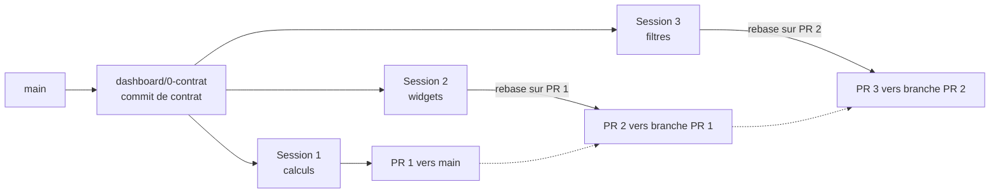

# Spec — Dashboard des ventes

**Statut :** périmètre fonctionnel et décisions validés le 24 novembre 2026 ; contrat publié sur `dashboard/0-contrat`.

**Source :** [Dashboard des ventes — lancement](https://microsofteur-my.sharepoint.com/personal/asmaeyadaoui_microsoft_com/Documents/Recordings/Dashboard%20des%20ventes%20-%20lancement-20261123_223224-Meeting%20Recording.mp4?web=1), réunion du 23 novembre 2026.

## Objectif

Ajouter au registre de l’application une vue des ventes fictives, sans modifier la boutique. La priorité est l’exactitude des chiffres, puis leur présentation et leur filtrage.

Le dashboard doit préciser qu’il présente des **commandes fictives**, et non des paiements ou encaissements réels.

## Fonctionnement attendu

### Indicateurs et visuels

Pour les commandes correspondant aux filtres actifs, afficher :

- Le montant total des ventes, le nombre de commandes et le panier moyen.
- Les ventes par point de vente, en distinguant les magasins du portail en ligne.
- Les 10 produits principaux.
- L’évolution mensuelle des ventes.

Tous les indicateurs et visuels reposent sur le **même ensemble de commandes filtrées**. La sélection successive de périodes permet de les examiner l’une après l’autre ; aucune comparaison simultanée n’est prévue.

### Règles de calcul

- Une ligne vaut `quantity × unitPriceCents` : le prix historique enregistré comprend déjà la remise. Ne jamais utiliser le prix actuel du catalogue pour recalculer une vente passée.
- Une commande est comptée une seule fois ; le panier moyen est le total des ventes divisé par le nombre de commandes, arrondi selon la décision 2.
- Le canal provient de `orders.locationId → locations.channel` : `online` pour le portail et `store` pour les magasins. Les préférences du client ne déterminent pas le canal.
- Les montants sont calculés en cents entiers et affichés en USD. Les dépassements de précision et les données invalides doivent produire une erreur visible, jamais un chiffre approximatif ou inventé.
- Les dates de commande sont des dates UTC.
- Les commandes simulées ajoutées localement sont incluses au même titre que les données initiales.

### Filtres

La troisième tâche ajoute des filtres par **dates de début et de fin inclusives**, canal et point de vente. Les filtres se combinent ; sans restriction, toutes les commandes disponibles sont prises en compte.

Une période vide affiche un état explicite : zéro commande, zéro vente et aucun panier moyen calculé. Une saisie de dates invalide ou inversée doit être signalée visiblement.

## Données et limites

- Source initiale : `src/data/sales.json` ; copie locale et commandes simulées : `src/services/salesStorage.ts`. Modèles : `src/types/sales.ts` ; opérations monétaires existantes : `src/services/money.ts` ; formatage USD existant : `formatUSD` dans `src/services/checkout.ts`.
- L’application reste Vue 3 / TypeScript, locale au navigateur, sans serveur ni service externe. Le registre brut et les données existantes restent accessibles et inchangés par la consultation du dashboard.
- Ne pas présenter le registre comme protégé : aucun contrôle d’accès administrateur n’a été identifié dans l’application actuelle (voir décision 3).
- Hors périmètre : marge, export Excel ou CSV, paiements réels, taxes, expédition et prévisions.

## Critères de validation

1. **Réconciliation :** sur le seul jeu initial, du 1er au 31 mars 2025 inclus, obtenir **55 commandes et 646 092 cents**, soit **6 460,92 USD**. Cette référence ne s’applique pas à un stockage local enrichi.
2. **Prix et filtres :** un jeu de test avec prix catalogue différent, ligne remisée, deux canaux et deux dates démontre que les calculs utilisent les prix historiques et excluent les commandes hors sélection. Le portail n’est pas compté comme magasin.
3. **Interface :** les chiffres et visuels restent cohérents après filtrage ; une sélection vide et des données invalides sont signalées explicitement.
4. **Régression :** boutique, recherche, panier, commande simulée, registre brut et erreurs existantes restent fonctionnels. Une commande locale apparaît dans le dashboard lorsque les filtres la comprennent.
5. **Précision :** les totaux et regroupements conservent les cents exacts et signalent tout dépassement. La consultation ne modifie pas les données de ventes enregistrées.
6. **Parallélisme :** en dehors du commit de contrat (inclus dans la PR 1), chaque PR ne modifie que les fichiers dont sa session est propriétaire ; les rebases de la phase 2 se font sans conflit.

## Décisions validées

1. **Top 10 :** classement par chiffre d’affaires (`totalCents`) décroissant ; égalité départagée par quantité décroissante, puis par `productId` croissant. Au plus 10 produits.
2. **Panier moyen :** `totalCents / orderCount` arrondi au cent le plus proche, demi-cent arrondi vers le haut, calculé en entiers (par exemple `Math.floor((2 × total + count) / (2 × count))` avec contrôle de précision) ; `null` lorsque `orderCount === 0`.
3. **Accès :** le registre local sans authentification suffit. Aucune protection n’est ajoutée et le dashboard ne se présente pas comme protégé ou réservé.
4. **Outillage de test :** `@vue/test-utils` et `happy-dom` sont ajoutés en devDependencies dans le commit de contrat. Les fichiers de test de composants activent l’environnement DOM par la directive `// @vitest-environment happy-dom` en tête de fichier ; la configuration Vitest globale reste inchangée.

## Organisation : développement parallèle, intégration empilée

Les trois tâches sont codées **en parallèle**, chacune dans **sa propre session cloud**. L’ordre de la pile et les dépendances sont conservés :

| Ordre | Tâche | Base de la PR |
| --- | --- | --- |
| 1 | Calculs fiables | `main` |
| 2 | Widgets du dashboard | Branche de la PR 1 |
| 3 | Filtres | Branche de la PR 2 |

Le parallélisme repose sur trois règles :

1. **Un contrat partagé et figé** (types, signatures, composant de filtre minimal) est publié avant le lancement. Chaque session code contre ce contrat, pas contre le travail des autres.
2. **Un seul propriétaire par fichier.** Aucune session ne modifie un fichier qu’elle ne possède pas ; les rebases sont donc sans conflit.
3. **Seule l’intégration est séquentielle :** rebase sur la couche parente, tests complets, puis ouverture de la PR.

| Phase | Acteur | Contenu | Mode |
| --- | --- | --- | --- |
| 0 | Coordinateur | Décisions, contrat, branche `dashboard/0-contrat` | Avant lancement |
| 1 | Sessions 1, 2 et 3 | Développement et tests dans leurs propres fichiers | **Parallèle** |
| 2 | Sessions 1, puis 2, puis 3 | Rebase sur la couche parente, tests complets, push, PR | Séquentiel et court |
| 3 | Coordinateur | Enregistrement de la pile GitHub dans l’ordre 1 → 2 → 3 | Final |

Chaque session lit d’abord cette spec depuis sa branche de base et s’arrête à son périmètre. Chaque PR exécute `npm test` et `npm run build`.

### Phase 0 — Contrat partagé

Le coordinateur crée, depuis `main`, la branche `dashboard/0-contrat` contenant un unique commit de contrat :

1. Cette spec, complétée par les décisions validées.
2. La levée, à ses trois sources, de la consigne qui réservait le dashboard aux participants : `.github/copilot-instructions.md`, `README.md` et `src/App.test.ts` (termes `dashboard`, `analytics`, `kpi` et `chart` retirés ; interdiction des routes et autres termes conservée).
3. `src/types/salesDashboard.ts`, `src/services/salesDashboard.ts` et `src/components/SalesDashboardFilters.vue`, conformes au contrat ci-dessous.
4. L’outillage de test des composants (décision 4). Aucune session ne modifie ensuite `package.json` ni `package-lock.json`.

Le commit de contrat passe `npm test` et `npm run build`. Les trois sessions sont ensuite créées **simultanément**, toutes avec `dashboard/0-contrat` comme branche de base.

#### Contrat — `src/types/salesDashboard.ts`

Voir le fichier : filtres, totaux, KPI (`averageOrderCents` arrondi selon la décision 2), ventes par point de vente, par canal, top produits (classement selon la décision 1), ventes mensuelles (`YYYY-MM`, ordre chronologique croissant), résultat global et codes d’erreur `INVALID_FILTER`, `INVALID_DATA`, `UNREPRESENTABLE_AMOUNT`.

#### Contrat — `src/services/salesDashboard.ts`

La classe `SalesDashboardError` et la signature `computeSalesDashboard(data: SalesData, filters: SalesDashboardFilters = {}): SalesDashboardResult` sont définitives. Seul le corps de `computeSalesDashboard` est provisoire ; la PR 1 le remplace. Fonction pure : elle ne modifie jamais `data`.

Comportement attendu de la version finale :

- dates mal formées ou date de début postérieure à la date de fin : `INVALID_FILTER` ;
- point de vente inconnu : `INVALID_FILTER` ;
- canal et point de vente incompatibles : sélection vide, sans erreur ;
- commande ou ligne invalide, référence inconnue : `INVALID_DATA` ;
- dépassement de précision détecté par `src/services/money.ts` : `UNREPRESENTABLE_AMOUNT`.

#### Contrat — `src/components/SalesDashboardFilters.vue`

Props `modelValue: SalesDashboardFilters` et `locations: readonly SalesLocation[]` ; événement `update:modelValue` avec un `SalesDashboardFilters`. Ces props et événements sont définitifs. Le composant provisoire n’affiche rien et n’émet rien : avant la PR 3, le dashboard présente donc toutes les commandes.

#### Modification du contrat

Le contrat est figé. Si une session a besoin de le modifier, elle s’arrête et le demande au coordinateur. Celui-ci ajoute un commit sur `dashboard/0-contrat`, puis les trois sessions rebasent leur travail sur cette branche.

### Propriété des fichiers

| Fichiers | Propriétaire |
| --- | --- |
| `docs/specs/2026-11-24-dashboard-ventes.md`, `.github/copilot-instructions.md`, `README.md`, `src/App.test.ts`, `src/types/salesDashboard.ts`, `package.json`, `package-lock.json` | Coordinateur, en phase 0 uniquement |
| `src/services/salesDashboard.ts` (corps de `computeSalesDashboard`), `src/services/salesDashboard.test.ts` | Session 1 |
| `src/components/SalesDashboard.vue`, autres composants `src/components/SalesDashboard*.vue` et leurs tests, **sauf** `SalesDashboardFilters.*` ; `src/components/WorkshopDataView.vue` ; `src/App.vue` si nécessaire | Session 2 |
| `src/components/SalesDashboardFilters.vue` (corps, sans changer props ni événements), `src/components/SalesDashboardFilters.test.ts` | Session 3 |
| Tous les autres fichiers existants, dont `src/styles/transmute.css` et les services de stockage | Aucun : ne pas modifier |

Chaque session définit ses jeux de test dans ses propres fichiers de test ; il n’y a pas de fichier de fixtures partagé. Les styles restent locaux aux composants (`<style scoped>`). Un conflit de rebase signale une violation de propriété : la session s’arrête et en informe le coordinateur.

### Phase 2 — Intégration séquentielle

1. **Session 1 :** `npm test` et `npm run build`, push, ouverture de la PR 1 vers `main`. Le coordinateur signale aux sessions 2 et 3 que la branche de la PR 1 est disponible.
2. **Session 2 :** rebase sur la branche de la PR 1, ajout ou activation des tests qui exigent les vrais calculs, `npm test` et `npm run build`, push, ouverture de la PR 2 vers la branche de la PR 1.
3. **Session 3 :** rebase sur la branche de la PR 2, mêmes étapes, ouverture de la PR 3 vers la branche de la PR 2.
4. **Coordinateur :** enregistrement des trois PR comme pile GitHub, dans cet ordre.

Une session qui termine sa phase 1 avant sa couche parente attend ; elle n’ouvre pas sa PR vers `main` ni vers `dashboard/0-contrat`. Si une PR parente change après revue, les couches suivantes rebasent dans l’ordre et relancent `npm test` et `npm run build`.

### PR 1 — Calculs de ventes fiables

**Périmètre :** implémenter `computeSalesDashboard` dans `src/services/salesDashboard.ts` conformément au contrat, avec ses tests. Le service reçoit les données de ventes et les filtres, puis fournit les KPI, les ventes par localisation et canal, le top 10 et les totaux mensuels.

Le service applique les dates UTC inclusives et l’intersection des filtres ; il réutilise les garde-fous monétaires existants et ne modifie ni stockage, ni boutique, ni interface. Une période sans commande ne provoque aucune division par zéro.

**Tests :** référence de mars 2025 ; prix historique différent du catalogue ; remise ; deux canaux et dates ; combinaisons de filtres ; période vide ; dépassement ; codes d’erreur du contrat ; classement (décision 1) et arrondi (décision 2).

### PR 2 — Widgets dans le registre

**Périmètre :** construire `src/components/SalesDashboard.vue` et ses widgets, et l’intégrer au registre via `src/components/WorkshopDataView.vue`, qui reçoit déjà le jeu de ventes depuis `src/App.vue`. Utiliser exclusivement `computeSalesDashboard` pour les chiffres.

`SalesDashboard.vue` reçoit le jeu de ventes, conserve l’état `filters` (initialement `{}`), affiche `<SalesDashboardFilters v-model="filters" :locations="…">` au-dessus des widgets et recalcule le résultat à chaque changement de données ou de filtres. Avec le composant de filtre provisoire, les widgets présentent toutes les commandes disponibles ; les contrôles de filtre arrivent en PR 3.

Afficher les trois KPI, les ventes par magasin et portail, le top 10 et l’évolution mensuelle, avec les mentions de données fictives. Afficher un état vide (zéro commande, zéro vente, panier moyen non calculé) et un état d’erreur visible pour toute erreur levée, sans aucun chiffre. Conserver l’accès au registre brut et les parcours de la boutique. Conformément à la décision 3, aucun contrôle d’accès n’est ajouté et le dashboard n’est pas présenté comme protégé.

**Phase 1 (parallèle) :** widgets testés avec des `SalesDashboardResult` construits à la main ; état d’erreur testable avec le service provisoire.

**Phase 2 (après rebase sur la PR 1) :** valeurs sur des données connues avec les vrais calculs, consultation après une commande simulée, préservation des données et parcours existants.

### PR 3 — Filtres du dashboard

**Périmètre :** implémenter `src/components/SalesDashboardFilters.vue` sans changer ses props ni ses événements : dates de début et de fin, canal et point de vente. Chaque modification émet un nouvel objet `SalesDashboardFilters` via `update:modelValue`, sans muter la prop ; un champ vidé redevient absent. Les dates invalides ou inversées sont transmises telles quelles : le service lève `INVALID_FILTER` et le dashboard affiche l’erreur. Ne pas ajouter de comparaison simultanée ni modifier la boutique.

**Phase 1 (parallèle) :** composant et tests isolés : rendu des contrôles et des points de vente fournis en props, objet émis pour chaque contrôle.

**Phase 2 (après rebase sur la PR 2) :** chaque modification actualise ensemble les KPI et tous les visuels.

**Tests :** dates inclusives, chaque filtre et leurs combinaisons, distinction portail/magasins, sélection vide, dates invalides et inclusion ou exclusion d’une commande simulée locale. Vérifier également l’accès au registre et les parcours existants.
